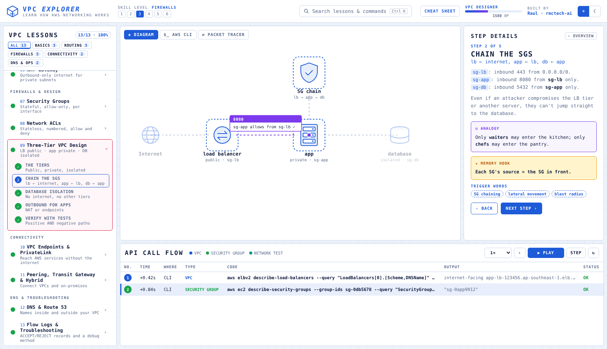

# 🌐 VPC Explorer — learn how AWS networking works

An interactive, step-by-step course on **Amazon VPC networking** for Cloud Engineers and Cloud Security learners. Every lesson animates packets through Internet Gateways, route tables, NAT, Security Groups and NACLs, with analogies, memory hooks, trigger words, quizzes, and a **Packet Tracer lab** that walks a packet hop by hop (including the stateless NACL return path) so you can fix broken networks yourself.

> Created by **Raul** ([@rmctech-ai](https://github.com/rmctech-ai)) · Freelance AI Automation Specialist on the path to Cloud Security.
> Part of the Explorer series: [Linux Explorer](https://github.com/rmctech-ai/linux-explorer) · [Python Explorer](https://github.com/rmctech-ai/python-explorer) · [IAM Explorer](https://github.com/rmctech-ai/iam-explorer) · [IaC Explorer](https://github.com/rmctech-ai/iac-explorer) · [Serverless Explorer](https://github.com/rmctech-ai/serverless-explorer) · [CI/CD Explorer](https://github.com/rmctech-ai/cicd-explorer) · [Cloud Security Explorer](https://github.com/rmctech-ai/cloudsecurity-explorer).
> Layout framework inspired by [Protocol Explorer](https://protocol-explorer-alpha.vercel.app/) by Dilum Sanjaya.



---

## ▶ Run it

No build step. Plain HTML/CSS/JS.

```bash
python3 -m http.server 8000     # then open http://localhost:8000
```

### Publish on GitHub Pages
```bash
git init && git add . && git commit -m "VPC Explorer"
git branch -M main
git remote add origin https://github.com/rmctech-ai/vpc-explorer.git
git push -u origin main
```
GitHub → **Settings → Pages → Deploy from a branch → `main` / root → Save** → `https://rmctech-ai.github.io/vpc-explorer/`

---

## 🧭 How to use it

| Area | What it does |
|---|---|
| **Lessons** (left) | 13 lessons grouped by track. Click to expand steps. Dots show progress. |
| **Diagram** tab | Animated scene for every step. |
| **$_ AWS CLI** tab | Types out real commands/code for the step with realistic output. |
| **⇄ PACKET TRACER** tab | **Packet Tracer**: edit a VPC config (subnets, route tables, NAT, NACLs, Security Groups, instances) as JSON, pick a packet (internet ↔ instance, instance ↔ instance), and trace every hop: route lookup, NACL rule match (stateless, ephemeral return ports), Security Group (stateful), public IP/IGW/NAT checks. Challenges auto-test reachability, including paths that must be blocked. |
| **Step Details** (right) | Explanation, **Analogy**, **Memory Hook**, **Trigger Words**, real-world notes, warnings. |
| **Api Call Flow** (bottom) | Log of every command so far with type, output and status. |
| **XP & levels** | Earn XP for steps, lessons, quizzes and challenges. Saved in your browser. |
| **Cheat Sheet** | Master hooks + key syntax for every lesson (also [`CHEATSHEET.md`](CHEATSHEET.md)). |

**Keyboard:** `→` / `←` steps · `Space` play · `Ctrl+K` search · `Esc` close.

---

## 📚 Curriculum (13 lessons · 65 steps · 52 quiz questions · 7 hands-on challenges)

| # | Lesson | Track | You'll learn |
|---|---|---|---|
| 01 | What is a VPC? | BASICS | Your private network in the cloud |
| 02 | CIDR & IP Addressing | BASICS | /16, /24, private ranges, reserved IPs |
| 03 | Subnets: Public, Private, Isolated | BASICS | What makes a subnet public |
| 04 | Route Tables ⚑ | ROUTING | Where every packet goes next |
| 05 | Internet Gateway & Public IPs ⚑ | ROUTING | The door to the internet |
| 06 | NAT Gateway ⚑ | ROUTING | Outbound-only internet for private subnets |
| 07 | Security Groups ⚑ | FIREWALLS | Stateful, allow-only, per interface |
| 08 | Network ACLs ⚑ | FIREWALLS | Stateless, numbered, allow and deny |
| 09 | Three-Tier VPC Design ⚑ | FIREWALLS | LB public · app private · DB isolated |
| 10 | VPC Endpoints & PrivateLink | CONNECTIVITY | Reach AWS services without the internet |
| 11 | Peering, Transit Gateway & Hybrid | CONNECTIVITY | Connect VPCs and on-premises |
| 12 | DNS & Route 53 | DNS & OPS | Names inside and outside your VPC |
| 13 | Flow Logs & Troubleshooting ⚑ | DNS & OPS | ACCEPT/REJECT records and a debug method |

⚑ = has a hands-on challenge.

## 🎯 Study plan & capstone

- **Week 1:** Lessons 1–6 (VPC, CIDR, subnets, routes, IGW, NAT). Solve every Packet Tracer challenge.
- **Week 2:** Lessons 7–9 (Security Groups, NACLs, three-tier design).
- **Week 3:** Lessons 10–13 (endpoints, peering/TGW/hybrid, DNS, flow logs & the final boss).

**Capstone:** Build a 6-subnet, 2-AZ VPC (public/app/db) in a free-tier account, a NAT gateway (delete it afterwards: it costs money), an S3 gateway endpoint, chained SGs, VPC Flow Logs, and a Reachability Analyzer test for 'LB → DB must fail'. Document the design and screenshots in a GitHub repo.

## License
MIT © 2026 Raul (rmctech-ai)
